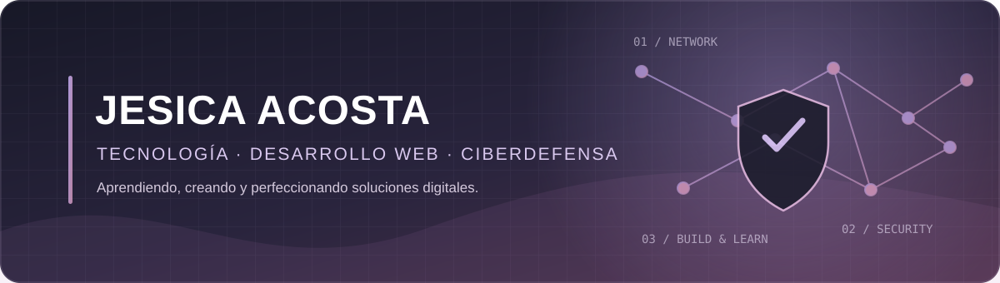

  

<a href="#sobre-mí">Sobre mí</a> ·
<a href="#áreas-de-interés-y-práctica">Áreas</a> ·
<a href="#proyectos-destacados">Proyectos</a> ·
<a href="#herramientas">Herramientas</a> ·
<a href="#contacto">Contacto</a>

---

## Sobre mí

Soy estudiante de **Licenciatura en Ciberdefensa** y trabajo como freelancer creando y personalizando sitios web. Mi recorrido combina formación académica, práctica técnica y proyectos para clientes.

Me interesa comprender cómo funcionan los sistemas de punta a punta: bases de datos, redes, infraestructura, aplicaciones y seguridad.

En mis trabajos web utilizo **Claude y ChatGPT** como asistentes para explorar y generar código. Mi aporte incluye revisar lo generado, adaptarlo a los requisitos, ajustar el diseño y el funcionamiento, probar y perfeccionar el resultado. La IA es parte de mi flujo de trabajo, no una afirmación de que desarrollo todo desde cero.

## Áreas de interés y práctica

<table>
  <tr>
    <td width="50%" valign="top">
      <h3>🛡️ Ciberseguridad y ciberdefensa</h3>
      Formación en fundamentos de seguridad informática, prevención y análisis.
    </td>
    <td width="50%" valign="top">
      <h3>🌐 Redes e infraestructura</h3>
      Conceptos de telecomunicaciones, topologías y prácticas de conectividad con Cisco Packet Tracer.
    </td>
  </tr>
  <tr>
    <td width="50%" valign="top">
      <h3>🗄️ Bases de datos</h3>
      Consultas SQL, conceptos de bases de datos relacionales y práctica con SQLite.
    </td>
    <td width="50%" valign="top">
      <h3>💻 Desarrollo web freelance</h3>
      Creación, personalización, revisión y publicación de sitios web.
    </td>
  </tr>
</table>

## Proyectos destacados

<table>
  <tr>
    <td width="50%" valign="top">
      <h3>✦ MísticaLab</h3>
      
Proyecto independiente de diseño y venta de indumentaria estampada. Incluye identidad de marca, catálogo y desarrollo de una experiencia web para presentar los productos.

      

        
        
      

    </td>
    <td width="50%" valign="top">
      <h3>⌁ JArg</h3>
      
Proyecto académico orientado a ciberseguridad, actualmente en etapa de diseño y desarrollo. La idea explora recursos de apoyo para reconocer posibles datos sensibles y revisar indicadores en URLs.

      

        
      

      
En desarrollo. No es una herramienta de seguridad validada ni debe utilizarse para proteger entornos productivos.

    </td>
  </tr>
</table>

  
<strong>🔍 Más sobre MísticaLab</strong>

  MísticaLab es un proyecto real en el que trabajo sobre la presentación digital de una marca de indumentaria. El sitio reúne decisiones de diseño, organización de contenidos y desarrollo web. Es una muestra de mi trabajo freelance y de cómo utilizo herramientas de IA dentro del proceso de creación y revisión.

  <a href="https://misticalab.netlify.app/">Abrir el sitio</a>

  
<strong>🧪 Más sobre JArg</strong>

  JArg es una iniciativa académica que estoy diseñando y desarrollando para explorar conceptos de ciberseguridad aplicada. Entre las ideas consideradas están la revisión heurística de URLs y la detección/enmascarado de posibles datos sensibles en textos.

  El alcance, las funciones y las validaciones siguen en proceso; por eso no lo presento como un producto terminado.

## Herramientas

  

Estas herramientas reflejan mi formación y práctica actual. El nivel de experiencia varía según la tecnología.

## Actualmente aprendiendo

- Ciberdefensa y fundamentos de seguridad informática.
- Bases de datos relacionales, SQL y SQLite.
- Redes, telecomunicaciones y simulaciones con Packet Tracer.
- Desarrollo web, publicación y mantenimiento de sitios.
- Uso crítico de herramientas de IA en procesos de desarrollo.

## Actividad en GitHub

  
<strong>📌 Qué vas a encontrar en mis repositorios</strong>

  Prácticas de programación, ejercicios de bases de datos, proyectos web y experiencias de aprendizaje. Algunos repositorios son trabajos académicos o experimentales y pueden estar incompletos.

## Contacto

  

Aprender · Construir · Probar · Mejorar

